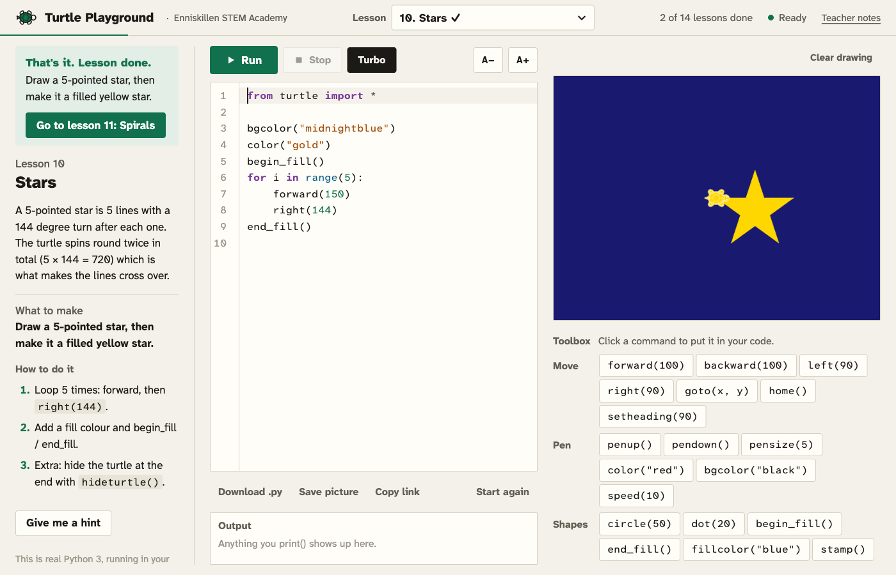

# ESA Turtle Playground

Learn Python with the turtle, in the browser. Made for Enniskillen STEM Academy students aged roughly 8 to 12.

Real Python 3 runs inside the page (via [Pyodide](https://pyodide.org)), with a drop-in `turtle` module that draws on a canvas. Nothing to install, no accounts, nothing leaves the computer. Everything students learn here works the same way in Thonny.



## What's in it

- **14 guided lessons** from "Hello, Turtle!" to functions, plus **6 challenges** (house, rainbow, Olympic rings, chessboard…). Each has a goal, steps, progressive hints, a worked solution, and a gentle completion check with a button to the next lesson.
- **Plain-English error messages.** `foward(100)` → "Did you mean `forward`?". A missing colon, a bracket never closed, an unexpected indent, an unknown colour: each gets a short explanation and the line is highlighted. Python's real error name is still shown underneath so they learn it.
- **Toolbox** of click-to-insert commands and colour swatches, so weak typists can still build programs.
- **Big, friendly editor** (CodeMirror) with line numbers, auto-indent, bracket matching, and A+ / A− text size.
- **Run / Stop / Turbo.** Stop kills runaway `while True:` loops. Turbo skips the animation.
- **Download .py** to open the program in Thonny. **Save picture** for the drawing. **Copy link** encodes the code in a URL to share with the teacher or take home.
- **Teacher notes** page at `/teacher/` with every lesson's solution, checks and teaching notes.
- Work is saved automatically in the browser (per lesson, per computer).

## Running it

### Option A: GitHub Pages (recommended for school use)

1. Push this repo to GitHub.
2. In the repo go to **Settings → Pages → Build and deployment → Source** and choose **GitHub Actions**.
3. Push to `main` (or run the "Deploy to GitHub Pages" workflow). The site appears at `https://<user>.github.io/<repo>/`.

Students just open the link. The first load fetches about 10 MB of Python; after that it's cached.

### Option B: On a laptop or classroom machine

You need Python 3 installed (it's only used as a tiny web server; the students' Python runs in the browser).

- **Mac:** double-click `Start Playground.command`
- **Windows:** double-click `start.bat`
- **Anything:** `python3 scripts/serve.py`

Then open <http://localhost:8008/>. The editor and fonts ship with the app; only Python (Pyodide) is fetched from the internet unless you vendor it (next section).

> Opening `index.html` directly by double-clicking does **not** work: browsers block web workers and file loading from `file://`. Use one of the launchers above.

### Option C: Fully offline

```bash
scripts/vendor_pyodide.sh       # downloads ~30 MB into vendor/pyodide
```

After that the app works with no internet at all. Fonts and the editor are already local (`fonts/`, `lib/codemirror/`). The `vendor/` downloads are git-ignored because they are large; run the scripts on each machine, or copy the whole folder onto a USB stick.

## Layout

```
index.html              the app
css/style.css
js/app.js               UI, editor, lesson flow, completion checks, share/download
js/canvas.js            animates turtle commands on the canvas
js/errors.js            Python error → plain-English explanation
js/palette.js           the toolbox definitions
js/lessons.js           lesson and challenge content  ← edit this to change lessons
js/worker.js            web worker that hosts Pyodide
py/turtle.py            the browser turtle module (same API as the real one)
py/runner.py            runs student code and reports errors with line numbers
teacher/index.html      teacher notes, generated from js/lessons.js
scripts/                serve.py and the vendoring scripts
.github/workflows/      GitHub Pages deployment
```

## Adding or changing a lesson

Open `js/lessons.js`. Each lesson is an object like:

```js
{
  id: "square",                   // unique, used for saving progress
  title: "The square",
  emoji: "🟦",                    // no longer shown; lessons are numbered instead
  concept: "HTML explaining the idea",
  goal: "What they should end up with",
  steps: ["step 1", "step 2"],
  starter: "from turtle import *\n\n",
  hints: ["first hint", "second hint"],
  solution: "from turtle import *\n...",
  checks: [
    { type: "equal_sides", n: 4, fail: "A square needs 4 equal sides." },
    { type: "turns", angle: 90, min: 3, fail: "Each corner is a 90 degree turn." },
  ],
  notes: "Shown on the teacher page only",
}
```

The comment at the top of `js/lessons.js` lists every check type. Checks are meant to be generous: they nudge, they don't grade.

## What the turtle module supports

All the usual commands: `forward/backward/left/right`, `goto/setx/sety/setheading/home`, `circle/dot/stamp/write`, `penup/pendown/pensize`, `color/pencolor/fillcolor/bgcolor` (names, `#hex`, or `(r, g, b)` with `colormode`), `begin_fill/end_fill`, `speed`, `hideturtle/showturtle`, `shape/shapesize`, `clear/reset`, `tracer/update`, `position/xcor/ycor/heading/distance/towards`, `title`, `Screen()`, multiple `Turtle()` objects, `done()/mainloop()/exitonclick()` (no-ops).

Not supported: `input()`, `textinput()`, `numinput()` (a friendly message says so) and keyboard/mouse events (accepted, but do nothing).

## Tech notes

- Student code runs in a web worker, so the Stop button can terminate it; the worker then reloads Python (a few seconds).
- Drawing commands stream from Python to the page as JSON batches and are animated with per-turtle speeds. If a program emits a huge number of commands, the animation switches to instant.
- Pyodide version is pinned in `js/app.js` (`PYODIDE_VERSION`) and `scripts/vendor_pyodide.sh`.

MIT licence.
